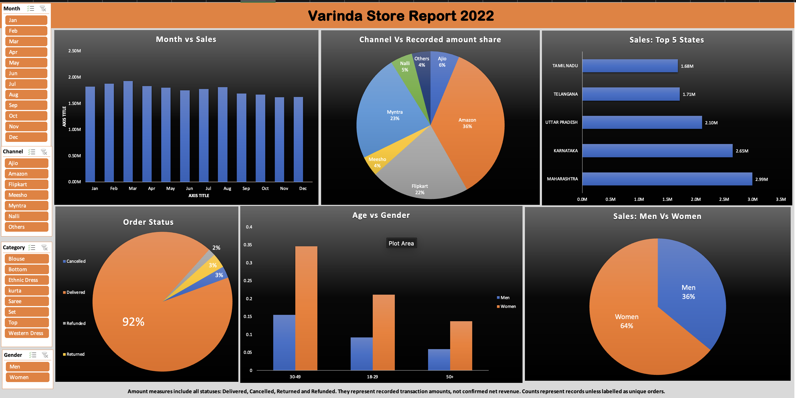

# Vrinda Store Analysis in Excel

A guided Excel portfolio project analysing recorded retail activity in 2022. The dashboard explores customer groups, channels, states, monthly activity and record status to identify questions for retail planning.

**Scope:** Historical portfolio analysis. Amounts include all statuses and represent recorded values, not confirmed net revenue or profit. Counts are records unless explicitly labelled as distinct Order IDs.

## Dashboard preview



[View dashboard PDF](./dashboard/Dashboard.pdf)

## Project files

- [Excel workbook](./workbook/Vrinda_Store_Portfolio.xlsx)
- [One-page executive summary](./reports/Executive_Summary.pdf)
- [Five-slide presentation](./reports/Presentation.pptx)

Download the workbook and open it in Microsoft Excel to use its dashboard controls. GitHub previews and PDFs are static. The presentation charts contain editable snapshots and do not update from the workbook.

## Business questions

1. Which channels and customer groups account for the largest shares of recorded amount?
2. How does recorded activity vary by month and state?
3. How much activity appears under Delivered, Cancelled, Returned and Refunded statuses?
4. Which metric definitions and data-quality limitations affect interpretation?

## Tools and approach

**Tools:** Microsoft Excel, PivotTables, charts, slicers, COUNTIF, SUMIF, distinct-ID checks and age/date helper fields.

The workbook contains source data, a dashboard, supporting analysis sheets and a Validation sheet.

The analysis follows a guided tutorial, with additional metric corrections and validation documented in the workbook.

## Baseline metrics

| Measure | Result | Definition |
|---|---:|---|
| Records | 31,047 | Data rows excluding the header |
| Distinct Order IDs | 28,471 | Unique order identifiers, not unique customers |
| Recorded amount | INR 21,176,377 | Sum of Amount across all statuses |
| Delivered amount | INR 19,710,544 | Sum of Amount for Delivered records |
| Reporting year | 2022 | All inspected dates fall within 2022 |

Repeated Order IDs remain in the dataset. The 2,576 additional occurrences beyond distinct IDs are not automatically duplicate orders.

Their business meaning remains unresolved: they may represent product lines, repeated totals or other records. Amounts therefore describe the source entries rather than verified order-level revenue.

## Key findings

### Channel concentration

| Channel | Recorded amount INR | Share of recorded amount |
|---|---:|---:|
| Amazon | 7,519,933 | 35.51% |
| Myntra | 4,941,540 | 23.34% |
| Flipkart | 4,573,301 | 21.60% |
| Ajio | 1,331,427 | 6.29% |
| Nalli | 1,015,329 | 4.79% |
| Meesho | 927,606 | 4.38% |
| Others | 867,241 | 4.10% |

Amazon, Myntra and Flipkart together account for **80.44%** of recorded amount, calculated using unrounded values.

This measures concentration, not channel profitability or the return on additional advertising. Displayed percentages may not sum to exactly 100% because of rounding.

### Customer patterns

Women account for **INR 13,562,773**, or **64.05%** of recorded amount. Men account for **INR 7,613,604**.

These are shares of recorded amount, not shares of unique customers. The comparison does not establish that targeting one group would cause additional sales.

### Monthly activity

March has the highest recorded monthly amount at **INR 1,928,066**, with **2,819 records**.

The analysis covers one historical year. It does not establish recurring seasonality or year-over-year growth.

### Geographic comparison

Maharashtra leads the saved state comparison at **INR 2,990,221**, followed by:

- Karnataka: **INR 2,646,358**
- Uttar Pradesh: **INR 2,104,659**

State naming remains inconsistent elsewhere in the source, so the geographic analysis retains the workbook's existing labels.

### Status reconciliation

| Status | Records | Recorded amount INR |
|---|---:|---:|
| Delivered | 28,641 | 19,710,544 |
| Cancelled | 844 | 481,844 |
| Returned | 1,045 | 719,147 |
| Refunded | 517 | 264,842 |
| **Total** | **31,047** | **21,176,377** |

The **INR 1,465,833** associated with cancelled, returned and refunded records is not automatically a financial loss.

Refund accounting and the meaning of repeated Order IDs require clarification before estimating net revenue.

## Metric corrections and validation

- Distinguished record counts from distinct Order IDs.
- Changed the channel comparison from Count of Amount to **Sum of Amount**, displayed as a percentage of the grand total.
- Replaced descriptive age labels with **18–29, 30–49 and 50+**.
- Documented the all-status amount scope on the dashboard.
- Reconciled status counts and amounts to the full dataset.
- Independently recomputed baseline and channel totals from the source records for the reports.
- Confirmed that inspected dates fall within 2022 and that month labels agree with date values.

These checks validate the stated calculations, not every possible aspect of the data. Native Excel slicer interaction was not independently retested during report preparation.

## Recommendations

| Proposed action | Proposed owner | Next evidence needed |
|---|---|---|
| Review merchandising on the largest channels | Retail or e-commerce manager | Channel costs, margins and a controlled campaign comparison |
| Investigate cancelled, returned and refunded activity | Operations lead | Order histories, reason codes and consistent status definitions |
| Improve geographic and order-level data definitions | Data owner | Standard state mapping and confirmation of what repeated Order IDs represent |

These are proposed actions. The project does not claim realised sales growth, financial savings or causal effects.

## Limitations

- Repeated Order IDs have unresolved business meaning. Summed amounts may require adjustment if whole-order totals repeat across records.
- State names include case variants and labels such as DELHI and New Delhi.
- All-status amounts include cancelled, returned and refunded entries.
- Delivered amount is not a verified net-revenue measure.
- The dataset covers one historical year and does not describe current trading.
- Cost, margin and marketing exposure data are unavailable, so ROI and profitability cannot be calculated.
- Historical associations do not prove that a recommended action will improve performance.

## Learning source and attribution

This is a guided portfolio project.

Learning reference: [Vrinda Store project tutorial](https://www.youtube.com/watch?v=gTK5rNhWJyA), linked in the earlier project workbook.

The supplied workbook is the source for this analysis. The tutorial reference does not establish the original dataset's ownership, authenticity or redistribution licence.

No claim of proprietary store access or real client work is made.

## Repository structure

```text
vrinda-store-excel-analysis/
├── README.md
├── dashboard/
│   ├── dashboard.png
│   └── Dashboard.pdf
├── workbook/
│   └── Vrinda_Store_Portfolio.xlsx
└── reports/
    ├── Executive_Summary.pdf
    └── Presentation.pptx
```
